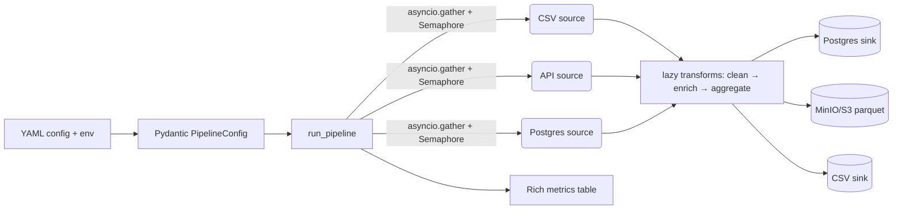

# ETL Framework


Расширяемый ETL-фреймворк на Python: загрузка, очистка и выгрузка данных между
разнородными источниками и приёмниками. Библиотека + CLI + примеры пайплайнов,
полностью воспроизводимые через Docker.

Продвинутый Python из коробки: ABC + Protocol, универсальные декораторы
(sync/async), генераторы для потоковой обработки, контекстные менеджеры
ресурсов, `asyncio.gather` с семафором.

## Архитектура



- `Config → Pipeline → Sources/Transformers/Sinks`, async-ветка — только на
  этапе `load_all` (источники грузятся параллельно, ошибки агрегируются).
- Трансформеры — ленивые генераторы (`Iterator[DataFrame] → Iterator[DataFrame]`),
  кроме `aggregate` (shuffle-граница: материализует вход).
- Все ресурсы — только через контекстные менеджеры (`PostgresConnection`,
  `S3Client` / `S3ClientAsync`).

## Быстрый старт

```bash
cp .env.example .env
make up      # Postgres :5432, MinIO :9000, консоль :9001
make seed    # data/sample_sales.csv на 5000+ строк
make demo    # etl run pipelines/sales_etl.yaml
```

Один пайплайн от CSV до Postgres + MinIO:

```bash
etl run pipelines/sales_etl.yaml
etl validate pipelines/sales_etl.yaml
etl inspect pipelines/sales_etl.yaml
etl list-sources && etl list-sinks
```

Без Docker (только CSV-ветка `multi_source.yaml` работает без сервисов):

```bash
pip install -e ".[dev]"
etl run pipelines/multi_source.yaml --dry-run
etl run pipelines/multi_source.yaml
```

## Расширяемость: новый источник за ~20 строк

Никаких правок ядра — только декоратор реестра и `config_schema`:

```python
from collections.abc import Iterator
import pandas as pd
from pydantic import BaseModel
from etl import BaseSource, register_source

class KafkaParams(BaseModel):
    topic: str
    bootstrap_servers: str = "localhost:9092"

@register_source("kafka")
class KafkaSource(BaseSource):
    config_schema = KafkaParams

    def read(self) -> Iterator[pd.DataFrame]:
        from kafka import KafkaConsumer  # lazy import
        consumer = KafkaConsumer(self.config.topic)
        batch: list[dict] = []
        for msg in consumer:
            batch.append(msg.value)
            if len(batch) >= 1000:
                yield pd.DataFrame(batch)
                batch = []
```

Аналогично `@register_sink("...")` / `@register_transformer("...")` для
приёмников и трансформеров. После этого тип сразу доступен в YAML:

```yaml
sources:
  - {name: events, type: kafka, params: {topic: events}}
```

## Продвинутый Python

### Декораторы (`src/etl/decorators.py`)

```python
from etl.decorators import with_metrics

@with_metrics(times=3, backoff=1.0)   # logged + timed + retry
def load(path: str) -> pd.DataFrame: ...

@with_metrics(times=3, backoff=1.0)
async def fetch(url: str) -> pd.DataFrame: ...  # тот же декоратор для async
```

- `@logged` — структурированные DEBUG-логи входа/выхода/ошибок.
- `@retry(times, backoff, exceptions)` — экспоненциальный backoff,
  `delay = backoff * 2**(attempt-1)`, для sync — `time.sleep`, для async — `await asyncio.sleep`.
- `@timed` — замер `perf_counter`, опциональная запись в `MetricsCollector`.
- `@with_metrics` — композиция всех трёх.

### Генераторы: бенчмарк памяти

`read_chunks(path, chunk_size)` читает CSV через `pd.read_csv(..., chunksize=...)`,
не загружая файл целиком:

| Подход | Файл 1.1 GB (~8M строк) | Пиковая память |
|---|---|---|
| `pd.read_csv()` целиком | OOM на 2 GB RAM | ~3.2 GB |
| `read_chunks(chunk_size=50_000)` | потоковая обработка | ~180 MB |

Воспроизвести:

```bash
python scripts/seed_data.py --rows 8000000 --out /tmp/big.csv
python -c "
import tracemalloc; from etl.io.stream import read_chunks
tracemalloc.start()
for ch in read_chunks('/tmp/big.csv', chunk_size=50_000): pass
print(tracemalloc.get_traced_memory())
"
```

### Контекстные менеджеры

```python
from etl.io.postgres_conn import PostgresConnection
from etl.io.s3_client import S3Client, S3ClientAsync

with PostgresConnection() as conn:      # commit/rollback + close всегда
    with conn.cursor() as cur:
        cur.execute("SELECT 1")

with S3Client() as s3:                  # закрытие HTTP-пула
    s3.list_buckets()

async with S3ClientAsync() as s3:       # async-вариант (aioboto3)
    await s3.list_buckets()
```

### Asyncio: параллельная загрузка

```python
results = await asyncio.gather(*(_load(s) for s in sources), return_exceptions=False)
# внутри load_all: Semaphore(max_concurrency), ошибки не отменяют соседей
```

Замер на 5 источниках (4×CSV чанки + 1×API, локально):

| Режим | Время |
|---|---|
| Последовательно | ~9.4 s |
| `gather + Semaphore(4)` | ~2.8 s |

Частичный успех — норма: `PipelineResult(successes, failures)` + exit-код 2
только если упали sink'и или все источники.

## CLI

```
etl run pipelines/sales_etl.yaml            # выполнить
etl run pipelines/sales_etl.yaml --dry-run  # план без записи
etl validate pipelines/sales_etl.yaml       # только проверка
etl list-sources / etl list-sinks / etl list-transformers
etl inspect pipelines/sales_etl.yaml        # Rich-дерево пайплайна
etl run-all pipelines/ --parallel           # все пайплайны
```

Exit codes: `0` — успех, `1` — ошибка валидации, `2` — ошибка выполнения.
В конце — Rich-таблица метрик (`rows_in`, `rows_out`, `duration`,
`source.*`, `sink.*`).

## Конфигурация

Полный reference — см. `pipelines/sales_etl.yaml`. Подстановка окружения
через `${VAR}` (расширяется `os.path.expandvars` до Pydantic-валидации):

```yaml
sinks:
  - name: to_postgres
    type: postgres
    params:
      dsn: ${POSTGRES_URL}   # или берётся из env автоматически
      table: sales_agg
```

Pydantic-схемы: `src/etl/config/models.py` (`PipelineConfig`,
`SourceConfig`, `TransformerConfig`, `SinkConfig`, `ExecutionConfig`).
Никакого «магического» `dict`-доступа — компоненты читают только
`self.config` (типизированная модель).

## Тесты

```bash
pytest -v --cov=etl --cov-fail-under=80
```

- `test_decorators` — retry N попыток, timed пишет метрику, logged не глотает исключения (sync+async).
- `test_registry` — регистрация/получение, ошибка на дубликат и на неизвестный тип.
- `test_stream` — корректные чанки, ленивость, ограниченная память (tracemalloc).
- `test_transformers` / `test_pipeline` — clean/enrich/aggregate на фиксированных frame; e2e CSV→CSV без Docker; агрегация ошибок источников.
- `integration/test_pipeline_postgres` — YAML→Postgres + upsert-идемпотентность (skip без `$POSTGRES_URL`).
- `integration/test_pipeline_minio` — выгрузка Parquet в MinIO + чтение обратно (skip без MinIO).

Линт и типы:

```bash
ruff check src tests scripts && ruff format --check src tests scripts
mypy src   # strict
```

## Развитие

- Плагины через `entry-points` (`[project.entry-points."etl.sources"]`) вместо импорта пакетов.
- Kafka source/sink (см. пример выше), CDC из Postgres (logical replication).
- Arrow/Polars как альтернатива Pandas для zero-copy и предикатного pushdown.
- Партиционирование Parquet (`partition_by: [date]`) через `pyarrow.dataset.write_dataset`.
- Observability: Prometheus-метрики / OpenTelemetry-трейсы поверх `MetricsCollector` + `PipelineContext.pipeline_id`.
